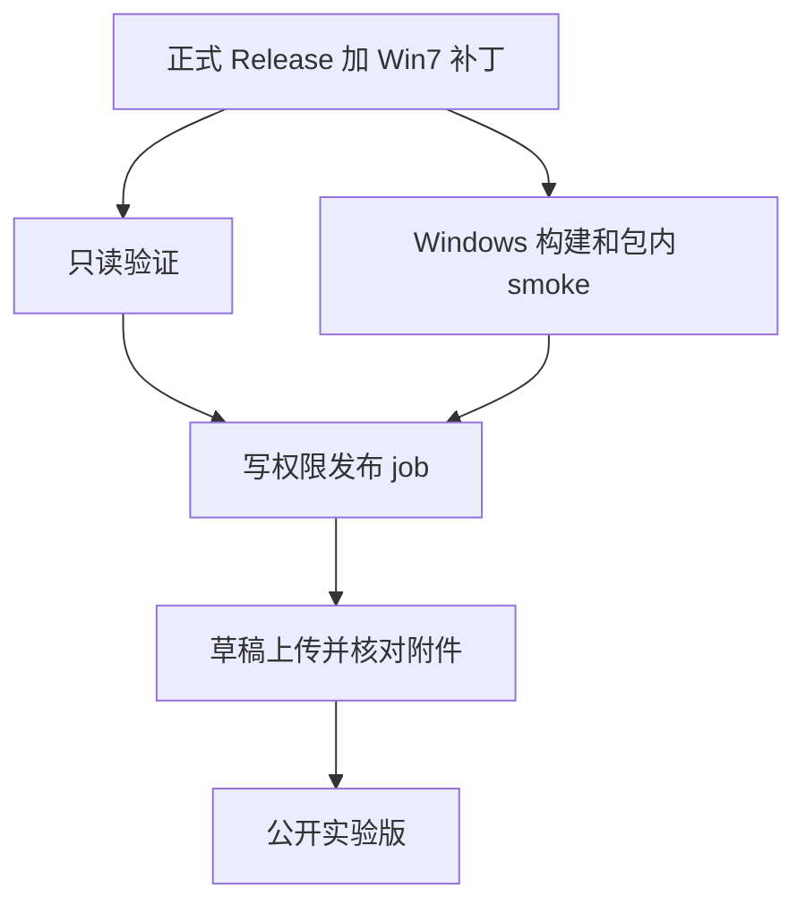

# 上游正式 Release 自动构建 Win7 版

## 规则与来源

来源固定为直接上游 `Zcode-CE/Zcode-CE` 的已发布正式 Release，排除 draft 和 prerelease。
不按 main 的普通提交触发构建，也不直接跟随 `zai-org/ZCode`。
每天 02:17 UTC 检查一次；从 v3.15.1-ce.1 的发布时间起，按发布时间顺序每轮处理一个尚未产出 Win7 版的正式 Release。
同一检查间隔内发布多个版本时按顺序逐轮处理，因此积压版本可能跨日构建，不会跳过中间版本。
没有待构建版本时直接结束检查，不运行完整验证、Windows 打包或发布。手动运行可以指定一个已发布正式 Release 的 tag。
定时任务须进入默认分支并在 Actions 中启用；功能分支的演练不代表定时任务已启用。

## 精确源码与补丁

发布 tag 必须解析到具体 Git commit，不能用 Release 的 target_commitish/main 代替。
候选树由该 tag 的完整源码应用 `patches/windows7-desktop.patch` 生成；三方应用补丁失败时直接停止，
不得改成构建 main、忽略补丁冲突或静默缺失 Win7 修改。
补丁基线与首次生成来源记录在 `config/windows7-release.json`；补丁是独立维护的应用改动，
不会把维护分支随后新增的上游未发布代码带进旧 Release。

`.github/workflows/**` 属于 fork 控制面，候选保留控制提交中的版本；除此之外不混入维护分支应用源码。
候选只有可信控制提交作为父提交，tree 则来自 Release+Win7 补丁；上游 tag SHA 单独写入清单。
这样 GitHub Token 不需要取得上游 workflow 的写权限，也不会把未受信任的上游 workflow 用作发布控制代码。
候选的 package.json.version 必须等于 tag 去掉 v 前缀的版本，安装包保留该上游版本号及 win7 文件名标记。

## 自动适配的边界

自动适配指对新正式 tag 重放已维护的 Win7 补丁并执行验证，不会自动编写或修复兼容代码。
上游修改相关实现、引入 Win7 不支持的 API 或原生依赖、提高运行时要求时，可能需要维护者更新补丁或固定运行时。
补丁应用或现有检查失败会停止发布，修复后须重新验证；检查只能发现其覆盖范围内的问题，不能保证任意新版本都兼容 Win7。
现代 Windows 上构建和 smoke 通过仍不代替 Win7 真机验收，因此自动产物保持 experimental。

## 检查、打包和发布

准备 job 只读生成 Git bundle 与来源清单。只读 Linux job 执行类型、Lint、格式、测试、架构检查；
只读 Windows job 构建 Win7 安装包，使用包内 EXE 检查 SQLite、WinPTY 和搜索工具。
候选 job 不保留 Git 凭据、不提供写 token。控制 job 不安装候选依赖，也不执行候选中的发布脚本。

发布状态由 GitHub Release 的 draft / prerelease 状态唯一保存；幂等键是上游 Release ID 和 tag commit。
控制分支 SHA 是验证租约，发生移动后旧候选不得发布。失败 draft 可由同一来源的重跑补齐。

只有验证和 Windows 构建全部成功，独立 contents:write job 才自动发布 fork 的 GitHub Release：

- Tag：`win7-<上游tag>`，例如 `win7-v3.15.1-ce.1`。
- 标为 prerelease，名称明确写 Win7 experimental；不接管常规桌面 latest 或自动更新源。
- 附件包括对应版本的 win7.exe、SHA256SUMS.txt、win7-release.json。
- 清单记录上游 Release ID/tag/commit、补丁 SHA-256、控制提交、候选提交、运行链接及附件哈希。

发布采用 draft → 上传并核对全部附件 → 转为公开 prerelease 的顺序。
失败保留 draft 以便重跑，不改动既有公开版本；未完成上传不能报告成功。
同来源且输出 tag 尚未创建的 draft，可在控制代码修复并重新验证后迁移到新候选；
输出 tag 已存在且指向旧候选时停止，需人工核查草稿与 tag，不能自动强推覆盖。
相同正式 Release 成功产出后不重复构建；上游重写同名 tag、已发布结果不完整或标签指向不符时失败，禁止覆盖。
构建过程中控制分支移动时停止发布，重新基于最新控制代码验证。
不依赖创建 PR 权限、不等待人工合并同步 PR；能够应用现有补丁并通过全部检查的上游正式版本，会自动生成可下载的 Win7 实验包。
现代 Windows smoke 不代替 Win7 真机验收，固定社区 Electron 版本和摘要不自动升级。

## 验收

1. 草稿、预发布、main 普通提交不触发 Release 构建；多个待处理正式版本按时间顺序逐一处理。
2. 即使维护分支领先于 tag，候选也不包含这些未发布应用代码；只包含显式 Win7 补丁和自有 workflow。
3. 真实补丁可应用于当前正式 Release，版本号与 tag 匹配，bundle 能被另一个 checkout 消费。
4. 补丁冲突、版本号不符、tag 被重写、候选摘要不符时停止。
5. 检查、打包、smoke、附件上传任一失败都不能发布公开 Release。
6. 发布重跑不重复创建版本，不覆盖已发布附件；成功版本具有可核对的全部清单和哈希。
7. 定时工作流只有进入默认分支且处于启用状态后才视为生效。
